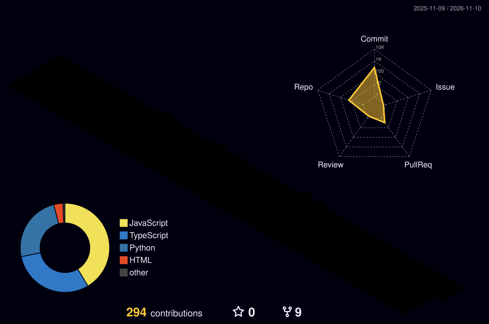

<div align="center">



<br />

<a href="https://www.linkedin.com/in/het-kothari"></a>
<a href="https://x.com/coolstrangerme"></a>
<a href="mailto:hetkothari09@gmail.com"></a>


</div>

<br />


<table>
<tr>
<td width="62%" valign="top">

I'm **Het**, a full-stack engineer who works where **data, money and automation** meet.

I build things that run in production: trading automation that places orders on its own, backtesting engines that turn market data into signals, AI tools for options strategy and HR, and complete web platforms from database to deploy.

```ts
const het = {
  role:      "Full-stack engineer · Data analyst",
  focus:     ["FinTech", "AI", "Automation"],
  shipping:  "Donation platform for a charitable trust founded in 1968",
  exploring: ["LLM agents", "options analytics", "3D on the web"],
  motto:     "Build systems, not scripts",
};
```

**Right now**

- 🛕 Shipping a two-trust donation platform with UPI payments, 80G receipts and a staff workspace
- 📈 Building options-chain analytics and strategy generation
- 🤖 Automating trading workflows end to end, from signal to order

</td>
<td width="38%" valign="top" align="center">



</td>
</tr>
</table>


<div align="center">

**Languages**


**Frontend and backend**


**Data, cloud and tools**


**Data science**


</div>


<table>
<tr>
<td width="50%" valign="top">

### 🛕 [Sadguru Seva Trust](https://github.com/hetkothari09/Sadguru-seva-trust)

Donation website and staff workspace for two charitable trusts: UPI and bank payments, 80G receipts, a temple seva site and a full donor ledger.

<a href="https://sadguruseva.up.railway.app"></a>
<a href="https://raghubirmandir.up.railway.app"></a>


</td>
<td width="50%" valign="top">

### 🤖 [AI Option Strategy Generator](https://github.com/hetkothari09/AI-Option-Strategy-Gen)

AI-driven creation of options strategies for the Indian markets.


</td>
</tr>
<tr>
<td width="50%" valign="top">

### 📊 [NSE Option Chain Analysis](https://github.com/hetkothari09/NSE_Option_Chain_Analysis)

End-to-end NSE option chain analysis, from fetching the chain to insight.


</td>
<td width="50%" valign="top">

### 🔬 [Signal Ideation with VectorBT](https://github.com/hetkothari09/signal_ideation_using_vectorbt)

A dynamic stock backtesting engine: generate signals, test strategies, read the numbers.


</td>
</tr>
<tr>
<td width="50%" valign="top">

### ⚡ [MegaTrader Automate](https://github.com/hetkothari09/MegaTrader_Automate)

Standalone automation for MegaTrader: funnels that place orders on their own.


</td>
<td width="50%" valign="top">

### 🧑‍💼 [Helix HR Assistant](https://github.com/hetkothari09/Helix-HR-Assistant)

An AI assistant for HR workflows.


</td>
</tr>
</table>


<div align="center">

<picture>
  <source media="(prefers-color-scheme: dark)" srcset="profile-3d-contrib/profile-night-rainbow.svg" />
  <source media="(prefers-color-scheme: light)" srcset="profile-3d-contrib/profile-green-animate.svg" />
  
</picture>

<picture>
  <source media="(prefers-color-scheme: dark)" srcset="https://raw.githubusercontent.com/hetkothari09/hetkothari09/output/github-snake-dark.svg" />
  <source media="(prefers-color-scheme: light)" srcset="https://raw.githubusercontent.com/hetkothari09/hetkothari09/output/github-snake.svg" />
  
</picture>

</div>


<div align="center">


</div>


<div align="center">

Open to interesting work in **FinTech, AI and full-stack products**. The fastest way to reach me:

<a href="mailto:hetkothari09@gmail.com"></a>

<br /><br />


<sub>The 3D globe, cube and section art are hand-built animated SVGs (<a href="assets/make_svgs.py">assets/make_svgs.py</a>). The contribution calendar and snake refresh every 12 hours.</sub>

</div>
